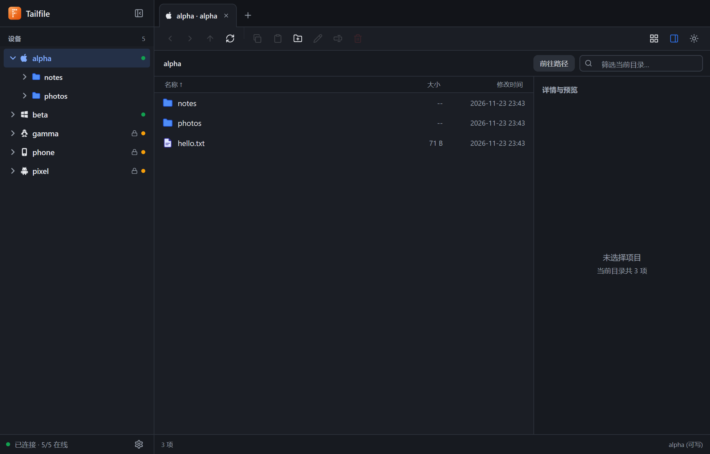

# Tailfile

[](https://github.com/botmiao/tailfile/actions/workflows/ci.yml)
[](https://github.com/botmiao/tailfile/releases/latest)
[](go.mod)
[](LICENSE)

English | [简体中文](README.zh-CN.md)

**Tailfile** is a unified single-binary file browser and Tailnet node agent written in pure Go (`CGO_ENABLED=0`) with a native desktop UI powered by [MyGo](https://github.com/egoist/mygo).

Install one executable everywhere: run `tailfile` directly for zero-config desktop file browsing and tray background sharing, or run `tailfile service install` / `tailfile agent` on headless servers.



## Platform Support & Roadmap

| Platform | Architectures | Status | Distribution |
| --- | --- | --- | --- |
| **Windows** | `amd64`, `arm64` | Supported (`v0.2.0`) | `install.ps1` / `.zip` |
| **macOS** | `amd64`, `arm64` | Supported (`v0.2.0`) | `install.sh` / `.tar.gz` |
| **Linux** | `amd64`, `arm64` | Supported (`v0.2.0`) | `install.sh` / `.tar.gz` |
| **Android / iOS** | `arm64` | Roadmap | Responsive `<820pt` mobile UI is ready in code; mobile `tsnet` login and `.apk`/`.ipa` installers are planned next |

## Prerequisites

- [Tailscale](https://tailscale.com/) installed and signed in on each machine (Tailfile connects to the local `tailscaled` daemon by default via `--net system`).
- **Linux**: if your local `tailscaled` socket is restricted to root, grant your user operator permission once:
  ```sh
  sudo tailscale set --operator="$USER"
  ```
- Trying the built-in 5-node offline demo (`tailfile --demo`) requires **no** Tailscale installation or network access.

## Installation

### Windows (PowerShell)

Installs `tailfile.exe` into `%LOCALAPPDATA%\Tailfile`, verifies SHA-256 against `SHA256SUMS.txt`, adds it to your user `PATH`, and creates a Start Menu shortcut:

```powershell
irm https://github.com/botmiao/tailfile/releases/latest/download/install.ps1 | iex
```

Optional environment overrides: `TAILFILE_VERSION=0.2.0`, `TAILFILE_INSTALL_DIR`, `TAILFILE_SERVICE=1` (also registers the per-user logon task).

### Linux & macOS

Installs `tailfile` into `~/.local/bin` and verifies SHA-256 against `SHA256SUMS.txt`:

```sh
curl -fsSL https://github.com/botmiao/tailfile/releases/latest/download/install.sh | sh
```

To install on a headless server and register the per-user background service (`systemd --user` or macOS `LaunchAgent`) in one step:

```sh
curl -fsSL https://github.com/botmiao/tailfile/releases/latest/download/install.sh | sh -s -- --service -- --read /srv/share --write /srv/drop
```

Pass `--version <ver>`, `--prefix <dir>`, or `--help` after `sh -s --` to customize the installation.

### Manual Download

Download the archive for your OS/architecture and `SHA256SUMS.txt` directly from [GitHub Releases](https://github.com/botmiao/tailfile/releases/latest).

## Key Features

- **Single Binary, Zero Install Friction**:
  - `tailfile` embeds the agent in-process over an in-memory transport (`memRoundTripper`), opening only the Tailnet peer port `:8644` with zero local `:8645` TCP listener or `gui-token` on disk, and closes to the desktop system tray so shares and transfers stay active in the background.
  - Headless servers running `tailfile agent` or `tailfile service install` also open only `:8644` by default (pass `--local 127.0.0.1:8645` only when local loopback API attachment is needed).
  - Default shared folder `~/Tailfile` is ready for reading and writing out of the box (pass `--read-only` or `--read` without `--write` to restrict writes).
- **Direct Tailnet Transfers**: Point-to-point node copies with chunked resumable partial files (`.tailfile-partial`), SHA-256 verification, and non-dismissible file conflict prompts (`Overwrite` / `Skip` / `Cancel`, plus `Apply to all`).
- **Scoped Security**: Reads and writes stay strictly within `--read` / `--write` roots (and Tailscale ACL `tailfile.dev/cap/files` capabilities when present); symlinks escaping shared roots are rejected, and `:8644` rejects browser CORS/Fetch headers (`Origin`, `Sec-Fetch-*`) as well as non-Tailnet `Host` headers.
- **Native Desktop UI & Responsive Layout**:
  - Light & Dark themes following system appearance or manual override, plus configurable layout density (`Auto`, `Compact`, `Standard`, `Comfortable`, persisted in `<StateDir>/ui.json`).
  - Tabs (`Ctrl/Cmd+T` / `+` device picker, `Ctrl/Cmd+W` or middle-click close, `Ctrl/Cmd+Shift+T`, sidebar middle/right-click open in new tab), collapsible sidebar with lazy-loaded directory tree (`ui.Outline` with configurable single-root flattening and active-folder sync), breadcrumbs, List & Icon views with desktop marquee drag-selection, image/text/PDF previews, built-in UTF-8 plain-text editor (`Ctrl/Cmd+S`, `Ctrl/Cmd+F`, LF/CRLF preservation, read-only viewer on RO nodes), and OS drag-in/drag-out.
  - **5-Node Offline Demo (`tailfile --demo`)**: Built-in sandbox with `alpha` (macOS, RW), `beta` (Windows, RW), `gamma` (Linux, RO), `pixel` (Android, RO), and `phone` (iOS, RO).

## Quick Start

### 1. Launch the Desktop App

```sh
tailfile
```

### 2. Try the 5-Node Interactive Demo

```sh
tailfile --demo
```

### 3. Run or Install on a Headless Server

```sh
# Install as a per-user background service (systemd --user / LaunchAgent / Windows Task Scheduler)
tailfile service install --read /srv/share --write /srv/drop

# Manage service lifecycle
tailfile service status
tailfile service stop
tailfile service uninstall

# Or run foreground in a terminal
tailfile agent --read /srv/share --write /srv/drop
```

## CLI Reference

| Command | Purpose |
| --- | --- |
| `tailfile [flags]` | Open native GUI (embeds agent in-process with desktop close-to-tray background sharing) |
| `tailfile --demo` | Open GUI with isolated 5-node in-memory demo Tailnet |
| `tailfile agent [flags]` | Run headless background agent (`:8644` on Tailnet; loopback API off unless `--local` is set) |
| `tailfile service <install\|uninstall\|start\|stop\|status> [flags]` | Manage per-user background daemon without root/admin privileges |
| `tailfile version` / `--version` | Print Tailfile version (`0.2.0`) |
| `tailfile help` / `--help` | Show CLI usage and flags |

### Common Flags

- `--read <paths>` / `--write <paths>`: Comma-separated read/write shared directory roots (default `~/Tailfile` RW)
- `--read-only`: Disable writes even on default `~/Tailfile`
- `--net <system\|tsnet>`: Use existing local `tailscaled` (`system`, default); `--net tsnet` (with `--authkey` / `--ephemeral`) is experimental and opt-in only via CLI flags
- `--hostname <name>`, `--state <dir>`, `--port <8644>`, `--local <127.0.0.1:8645>` (`--local` disabled by default)
- `--authkey <key>` (or `TS_AUTHKEY`), `--owner <login>` (or `TAILFILE_OWNER`): Optional owner login or experimental `tsnet` auth key
- `--agent <url>` (or `TAILFILE_AGENT`), `--attach-only`, `--token-file <path>`: GUI external-daemon options

## Building from Source

Requires Go 1.27+ (`CGO_ENABLED=0`, no WebView runtime or C toolchain required for desktop builds).

**Windows (PowerShell)**

```powershell
# Regenerate Windows PE resources (rsrc_windows_*.syso) if resources/icon.png or mygo.json changes
go generate .

$env:CGO_ENABLED = "0"
go build -tags mygo_nowebview -ldflags "-s -w -H=windowsgui" -o tailfile.exe .
```

**Linux / macOS (Bash)**

```sh
CGO_ENABLED=0 go build -tags mygo_nowebview -ldflags "-s -w" -o tailfile .

# Or cross-compile and package all 6 desktop release archives into ./dist
bash scripts/build-all.sh
```

**Run Tests**

```sh
go test -count=1 ./...
```

## Documentation

- [UI Design & Architecture](docs/UI.md)
- [Testing & Verification Guide](docs/TESTING.md)
- [Implementation Notes](docs/IMPLEMENTATION_NOTES.md)
- [Changelog](CHANGELOG.md)

## License

[MIT](LICENSE)
