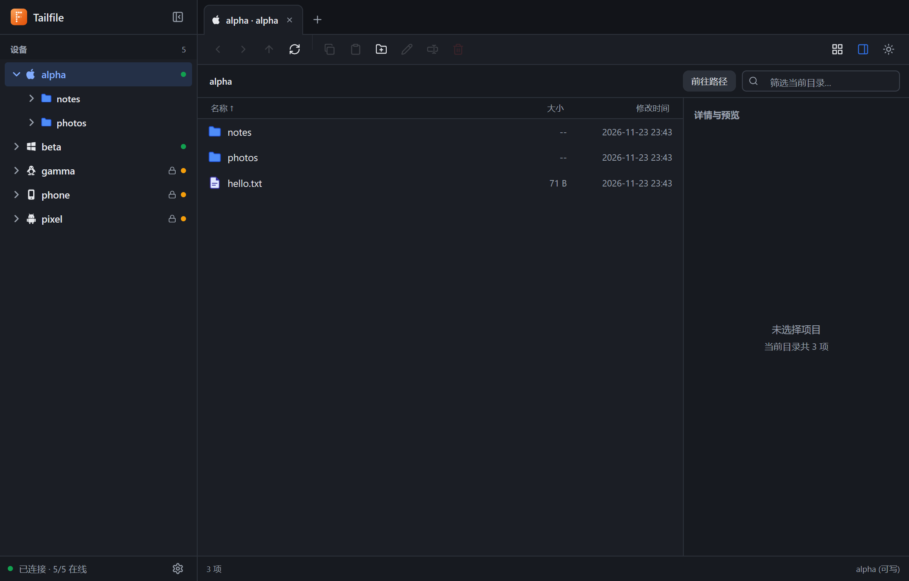

# Tailfile

[](https://github.com/botmiao/tailfile/actions/workflows/ci.yml)
[](https://github.com/botmiao/tailfile/releases/latest)
[](go.mod)
[](LICENSE)

[English](README.md) | 简体中文

**Tailfile** 是一款纯 Go（`CGO_ENABLED=0`）实现的单文件 Tailnet 节点文件浏览器与后台守护程序，桌面原生界面基于 [MyGo](https://github.com/egoist/mygo) 构建。

全平台只需部署同一个可执行文件：桌面端直接运行 `tailfile` 即可零配置浏览文件并最小化到系统托盘持续共享；无头服务器运行 `tailfile service install` 或 `tailfile agent` 即可作为后台节点运行。



## 平台支持与路线图

| 平台 | 架构 | 当前状态 | 分发方式 |
| --- | --- | --- | --- |
| **Windows** | `amd64`、`arm64` | 已支持（`v0.2.0`） | `install.ps1` / `.zip` |
| **macOS** | `amd64`、`arm64` | 已支持（`v0.2.0`） | `install.sh` / `.tar.gz` |
| **Linux** | `amd64`、`arm64` | 已支持（`v0.2.0`） | `install.sh` / `.tar.gz` |
| **Android / iOS** | `arm64` | 规划中（Roadmap） | 代码中已完成 `<820pt` 响应式移动端界面；移动端 `tsnet` 登录与 `.apk`/`.ipa` 安装包将在后续版本发布 |

## 前置条件

- 每台节点设备已安装并登录 [Tailscale](https://tailscale.com/)（Tailfile 默认通过 `--net system` 连接本机 `tailscaled` 服务）。
- **Linux 权限提示**：若本机 `tailscaled` socket 仅限 root 访问，请为当前用户授予一次操作权限：
  ```sh
  sudo tailscale set --operator="$USER"
  ```
- 如果只是体验内置 5 节点离线演示模式（`tailfile --demo`），则**不需要**安装 Tailscale，也无需联网。

## 安装

### Windows（PowerShell）

自动下载对应架构安装包，校验 `SHA256SUMS.txt` 后安装到 `%LOCALAPPDATA%\Tailfile`，加入用户 `PATH` 并创建开始菜单快捷方式：

```powershell
irm https://github.com/botmiao/tailfile/releases/latest/download/install.ps1 | iex
```

支持通过环境变量自定义行为：`TAILFILE_VERSION=0.2.0`、`TAILFILE_INSTALL_DIR`、`TAILFILE_SERVICE=1`（同时注册当前用户后台登录任务）。

### Linux 与 macOS

自动下载对应架构压缩包，校验 `SHA256SUMS.txt` 后安装到 `~/.local/bin`：

```sh
curl -fsSL https://github.com/botmiao/tailfile/releases/latest/download/install.sh | sh
```

如需在无头服务器上一步安装并注册用户级后台服务（`systemd --user` 或 macOS `LaunchAgent`）：

```sh
curl -fsSL https://github.com/botmiao/tailfile/releases/latest/download/install.sh | sh -s -- --service -- --read /srv/share --write /srv/drop
```

可在 `sh -s --` 后附加 `--version <ver>`、`--prefix <dir>` 或 `--help` 自定义安装路径与版本。

### 手动下载

也可直接前往 [GitHub Releases](https://github.com/botmiao/tailfile/releases/latest) 下载对应系统的 `.tar.gz` / `.zip` 压缩包与 `SHA256SUMS.txt`。

## 核心特性

- **单文件零配置**：
  - 桌面端直接运行 `tailfile` 时，以内存传输通道（`memRoundTripper`）在进程内嵌入节点服务，仅监听 Tailnet 节点端口 `:8644`，不开启本机 `:8645` 端口也不写 `gui-token` 文件，关闭主窗口可缩入系统托盘保持共享与传输不断线。
  - 无头服务器运行 `tailfile agent` 或 `tailfile service install` 同样默认只监听 `:8644`（仅在需要本地 API 调试或外挂连接时显式传入 `--local 127.0.0.1:8645`）。
  - 默认将 `~/Tailfile` 作为可读写共享根目录开箱即用（传入 `--read-only` 或只传 `--read` 时保持只读）。
- **Tailnet 点对点传输**：节点间直接复制文件，支持分块断点续传（`.tailfile-partial`）、SHA-256 完整性校验，以及不可误关的冲突处理弹窗（覆盖 / 跳过 / 取消，支持「对后续冲突应用相同操作」）。
- **根目录沙箱与边界防护**：所有读写严格限制在 `--read` / `--write` 根目录及 Tailscale ACL `tailfile.dev/cap/files` 授权范围内，请求时实时解析符号链接并拒绝越界路径，`:8644` 拒绝浏览器 CORS/Fetch 请求头（`Origin`、`Sec-Fetch-*`）及非 Tailnet `Host` 头。
- **原生桌面交互与密度调节**：
  - 支持浅色 / 深色 / 跟随系统主题，以及「自动 / 紧凑 / 标准 / 宽松」四档布局密度设置（保存在 `<StateDir>/ui.json`）。
  - 支持多标签页（`Ctrl/Cmd+T` 新建设备选择页、`Ctrl/Cmd+W` 或中键关闭、`Ctrl/Cmd+Shift+T` 恢复关闭页、侧边栏中键或右键在新标签页打开）、可收起侧边栏与懒加载目录树（`ui.Outline`，支持单根展平与自动定位）、面包屑导航、列表/图标视图、桌面端空白拖拽框选、图片/文本/PDF 预览、内置 UTF-8 文本编辑器（`Ctrl/Cmd+S`、`Ctrl/Cmd+F`、保留 LF/CRLF、只读节点全文查看）以及系统文件拖入/拖出。
  - **5 节点离线演示（`tailfile --demo`）**：内置隔离演示集群，包含 `alpha`（macOS，可写）、`beta`（Windows，可写）、`gamma`（Linux，只读）、`pixel`（Android，只读）和 `phone`（iOS，只读）。

## 快速开始

### 1. 启动桌面应用

```sh
tailfile
```

### 2. 体验 5 节点离线演示

```sh
tailfile --demo
```

### 3. 在服务器运行或安装后台服务

```sh
# 注册当前用户后台服务（systemd --user / LaunchAgent / Windows 任务计划程序）
tailfile service install --read /srv/share --write /srv/drop

# 查看状态或启停服务
tailfile service status
tailfile service stop
tailfile service uninstall

# 或在前台终端直接运行
tailfile agent --read /srv/share --write /srv/drop
```

## CLI 命令与参数

| 命令 | 说明 |
| --- | --- |
| `tailfile [flags]` | 启动桌面原生界面（进程内嵌入节点，关闭窗口默认缩入托盘） |
| `tailfile --demo` | 启动内置 5 节点内存演示 Tailnet |
| `tailfile agent [flags]` | 运行无头后台节点（监听 Tailnet `:8644`，未传 `--local` 时关闭本地端口） |
| `tailfile service <install\|uninstall\|start\|stop\|status> [flags]` | 免管理员权限管理当前用户后台服务 |
| `tailfile version` / `--version` | 打印当前版本（`0.2.0`） |
| `tailfile help` / `--help` | 查看命令与参数说明 |

### 常用参数

- `--read <paths>` / `--write <paths>`：逗号分隔的可读/可写共享目录列表（默认读写 `~/Tailfile`）
- `--read-only`：禁用写入（即使用默认 `~/Tailfile` 也保持只读）
- `--net <system\|tsnet>`：使用本机已登录的 `tailscaled`（默认 `system`）；`--net tsnet`（配合 `--authkey` / `--ephemeral`）为 CLI 实验特性
- `--hostname <name>`、`--state <dir>`、`--port <8644>`、`--local <127.0.0.1:8645>`（`--local` 默认关闭）
- `--authkey <key>`（或环境变量 `TS_AUTHKEY`）、`--owner <login>`（或 `TAILFILE_OWNER`）
- `--agent <url>`（或 `TAILFILE_AGENT`）、`--attach-only`、`--token-file <path>`：外挂连接独立运行中的本地 `tailfile agent`

## 从源码构建

需要 Go 1.27+（桌面构建全程 `CGO_ENABLED=0`，不依赖 WebView 运行时或 C 编译器）。

**Windows（PowerShell）**

```powershell
# 修改 resources/icon.png 或 mygo.json 后重新生成 Windows 资源文件（rsrc_windows_*.syso）
go generate .

$env:CGO_ENABLED = "0"
go build -tags mygo_nowebview -ldflags "-s -w -H=windowsgui" -o tailfile.exe .
```

**Linux / macOS（Bash）**

```sh
CGO_ENABLED=0 go build -tags mygo_nowebview -ldflags "-s -w" -o tailfile .

# 或交叉编译全部 6 端发布压缩包到 ./dist
bash scripts/build-all.sh
```

**运行全量测试**

```sh
go test -count=1 ./...
```

## 相关文档

- [UI 设计与架构](docs/UI.md)
- [测试与验证说明](docs/TESTING.md)
- [实现细节笔记](docs/IMPLEMENTATION_NOTES.md)
- [更新日志](CHANGELOG.md)

## 开源协议

基于 [MIT](LICENSE) 协议开源。
